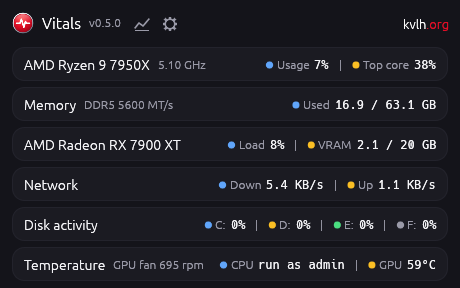
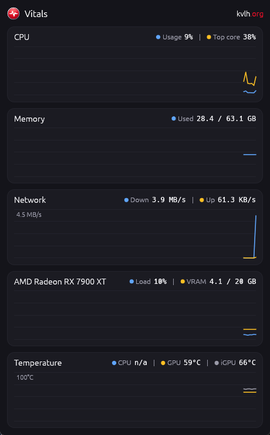
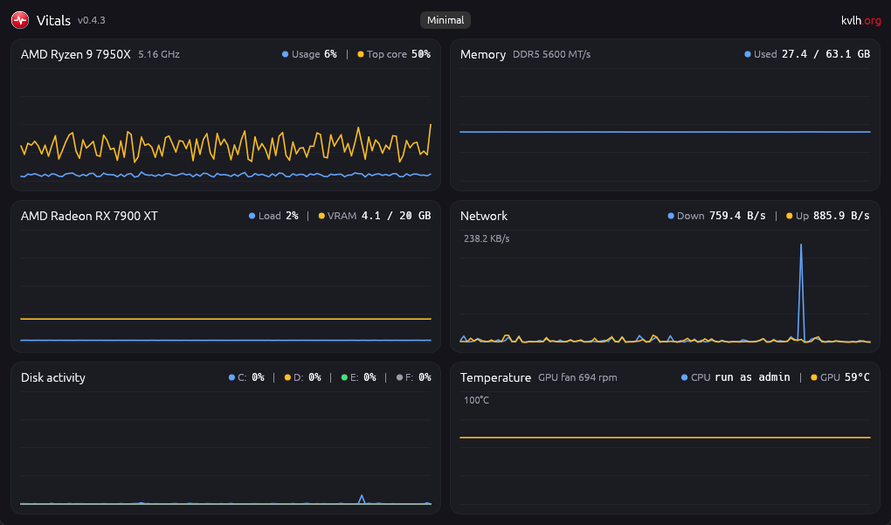
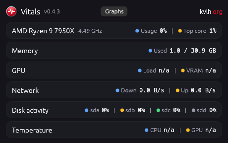
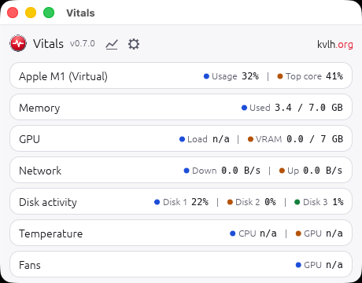

<p align="center"></p>

<h1 align="center">Vitals</h1>

<p align="center">A small performance monitor. One line of live values per component, or one graph each with the last two minutes of history.<br>Rust + egui, for Windows, Linux and macOS.</p>

<p align="center">
  
</p>
<p align="center"><sub>Minimal mode, the default</sub></p>

<p align="center">
  
  
</p>
<p align="center"><sub>Graphs, narrow and wide</sub></p>

## What it shows

| Block | What it shows |
|---|---|
| CPU | Usage and busiest core; the title shows the CPU name and current clock |
| Memory | Used, against total, with the RAM type and speed in the title. Amber from 80% used, red from 90% |
| GPU | Load, VRAM |
| Network | Download, upload on physical adapters only, so VPN and virtual adapter traffic is not counted twice |
| Disk activity | Share of time each physical disk is busy (Task Manager's "active time") |
| Temperature | CPU and GPU, plus the GPU fan speed. CPU turns amber at 90 °C and red at 95 °C (Ryzen 7000 runs at 95 °C by design), GPU at 80 °C and 90 °C |

It samples once per second. The window shows one column when narrow and two when wide, and remembers its size and position. It starts in **minimal mode**: one line of values per block, in a window sized to fit. The chart icon next to the version shows the graphs, and the rows icon goes back. The mode is remembered. Everything except the Windows CPU temperature works without a driver or admin rights.

The gear icon next to it opens the settings:

- **Theme**: System (the default, follows the OS), Light or Dark.
- **Start at sign-in**: on Windows, a Task Scheduler task named `Vitals` that starts it with administrator rights (see below); changing it from a Vitals that is not running as administrator asks for a UAC confirmation. On Linux, an entry in `~/.config/autostart`. On macOS, a LaunchAgent in `~/Library/LaunchAgents`. It always starts the copy of Vitals you set it from, so set it again after moving the app.

## What each OS can show

| | Windows | Linux | macOS |
|---|---|---|---|
| CPU, memory | Yes | Yes | Yes |
| CPU clock | Yes, computed like Task Manager | Yes, average of cores | Yes (not checked on Apple silicon) |
| RAM type and speed | Yes (SMBIOS) | No: needs root | No |
| Disk activity | Yes, by drive letter | Yes, by device (sda, nvme0n1) | Yes, as Disk 1, Disk 2 |
| Network | Yes | Yes | Yes (en* interfaces) |
| GPU load, VRAM | Yes, any vendor | AMD only (amdgpu) | Yes; memory shown against RAM, which the GPU shares |
| GPU temperature | Yes, same source as Task Manager | AMD only | No public API |
| GPU fan | When the driver reports it | AMD only | No |
| CPU temperature | AMD Ryzen, with PawnIO and admin rights (see below) | Yes (k10temp, coretemp) | Apple silicon die sensors |

Where a value is not available, the legend shows `n/a`.

## CPU temperature on Windows

Windows has no way to read an AMD CPU temperature without a kernel driver. Vitals bundles [PawnIO](https://pawnio.eu), the Microsoft-signed driver LibreHardwareMonitor also uses, which only runs signed, purpose-built modules.

1. Right-click `vitals-windows-x64.exe`, then **Run as administrator**. The PawnIO device only accepts administrators.
2. The first time, Vitals asks whether to install the bundled PawnIO 2.2.0 driver. Accept, and the CPU temperature appears.
3. It then offers to start when you sign in, with administrator rights and no UAC prompt. This is the **Start at sign-in** setting (gear icon), where you can turn it off again.

Without admin rights the legend shows `run as admin` and everything else works as usual. On an unsupported CPU it shows `AMD only`.

Supported: AMD Ryzen and EPYC from Zen to Zen 5 (families 17h to 1Ah). Not yet: Intel. Tested on a Ryzen 9 7950X with Memory Integrity on. Bundled file versions and licenses are listed in [`assets/pawnio`](assets/pawnio/README.md).

## Download and run

Prebuilt binaries are on the [Releases](../../releases) page.

- **Windows**: run `vitals-windows-x64.exe`. It is not code-signed, so SmartScreen may ask for confirmation the first time.
- **Linux**: `tar xzf vitals-linux-x64.tar.gz && ./vitals`. Needs X11 or Wayland with OpenGL.
- **macOS**: unzip `vitals-macos-universal.zip` and move `Vitals.app` to Applications. The app is ad-hoc signed, not notarized: open it the first time with right-click, Open, or run `xattr -dr com.apple.quarantine Vitals.app`. Universal build for Apple silicon and Intel.

## Resource use

Measured on Windows 11 with a Ryzen 9 7950X and a Radeon RX 7900 XT: about 0% CPU and 60 to 110 MB of private memory depending on the moment, most of it the graphics driver's OpenGL runtime. Reading the CPU temperature through PawnIO adds no measurable cost. The executable is 8 MB, 3.3 MB of which is the PawnIO installer, only used the first time.

## Build

```sh
cargo build --release
```

- `.github/workflows/build.yml` builds Linux (on Ubuntu 22.04, for an older glibc) and a universal, ad-hoc signed `Vitals.app` for macOS, then checks the app is still running after 10 seconds.
- `assets/vitals-icon.svg` is the icon source. `assets/make-icon.ps1` renders it into `vitals.ico`, `vitals.res` (embedded in the Windows exe by `build.rs`) and `macos/vitals.icns`.
- Platform code lives in `src/platform/`: one file per OS with the same small API.

## Status

- Windows: tested on Windows 11, values checked against Task Manager.
- Linux: the release build runs (tested under WSL, which has no GPU or temperature sensors). GPU and temperature readings are untested on real hardware.
- macOS: the release build runs on a GitHub macOS VM. GPU and disk readings are untested on a real Mac.

<p align="center">
  
  
</p>
<p align="center"><sub>Minimal mode on Linux under WSL (left, dark theme) and macOS in a GitHub VM (right, light theme). Neither VM has a real GPU or temperature sensors, hence the n/a values.</sub></p>

## License

[MIT](LICENSE)
